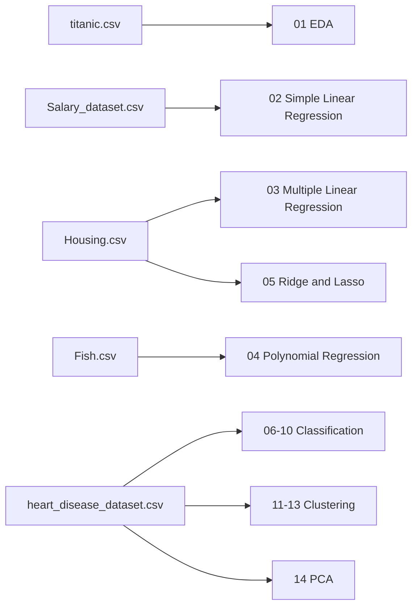

# Loyola College

## MSc Data Science — First Year

**Department:** Data Science  
**Student Name:** R Selva Rejo  
**Department Number:** 26 PDS 009

# Machine Learning Practical Record


A GitHub-ready collection of the **14 machine learning practical exercises** documented in the accompanying Word/PDF record. Each notebook follows the original exercise order and includes saved outputs, tables, metrics, and visualizations for direct viewing on GitHub.

## Project overview

```text
Practical record
      |
      +--> Data analysis ........ Titanic
      +--> Regression .......... Salary, Housing, Fish
      +--> Classification ...... Heart disease
      +--> Clustering .......... Heart disease
      +--> Dimensionality ...... Heart disease
```

The notebooks are grouped into a single ordered sequence:

```text
01 EDA
02-05 Regression
06-10 Classification
11-13 Clustering
14 PCA
```

## Exercise sequence

| No. | Notebook | Practical | Dataset |
|---:|---|---|---|
| 1 | [`01_eda_titanic.ipynb`](notebooks/01_eda_titanic.ipynb) | Exploratory Data Analysis | `titanic.csv` |
| 2 | [`02_simple_linear_regression.ipynb`](notebooks/02_simple_linear_regression.ipynb) | Simple Linear Regression | `Salary_dataset.csv` |
| 3 | [`03_multiple_linear_regression.ipynb`](notebooks/03_multiple_linear_regression.ipynb) | Multiple Linear Regression | `Housing.csv` |
| 4 | [`04_polynomial_regression_fish.ipynb`](notebooks/04_polynomial_regression_fish.ipynb) | Polynomial Regression | `Fish.csv` |
| 5 | [`05_regularization_ridge_lasso.ipynb`](notebooks/05_regularization_ridge_lasso.ipynb) | Regularization Techniques | `Housing.csv` |
| 6 | [`06_logistic_regression.ipynb`](notebooks/06_logistic_regression.ipynb) | Logistic Regression | `heart_disease_dataset.csv` |
| 7 | [`07_knn_classifier.ipynb`](notebooks/07_knn_classifier.ipynb) | K-Nearest Neighbour | `heart_disease_dataset.csv` |
| 8 | [`08_decision_tree_classifier.ipynb`](notebooks/08_decision_tree_classifier.ipynb) | Decision Tree Classification | `heart_disease_dataset.csv` |
| 9 | [`09_random_forest_classifier.ipynb`](notebooks/09_random_forest_classifier.ipynb) | Random Forest Classification | `heart_disease_dataset.csv` |
| 10 | [`10_support_vector_machine.ipynb`](notebooks/10_support_vector_machine.ipynb) | Support Vector Machine | `heart_disease_dataset.csv` |
| 11 | [`11_kmeans_clustering.ipynb`](notebooks/11_kmeans_clustering.ipynb) | K-Means Clustering | `heart_disease_dataset.csv` |
| 12 | [`12_hierarchical_clustering.ipynb`](notebooks/12_hierarchical_clustering.ipynb) | Hierarchical Clustering | `heart_disease_dataset.csv` |
| 13 | [`13_dbscan_clustering.ipynb`](notebooks/13_dbscan_clustering.ipynb) | DBSCAN Clustering | `heart_disease_dataset.csv` |
| 14 | [`14_principal_component_analysis.ipynb`](notebooks/14_principal_component_analysis.ipynb) | Principal Component Analysis | `heart_disease_dataset.csv` |

## Dataset map



## Repository structure

```text
my_expectations/
├── dataset/                 # Five datasets used by the record
├── notebooks/               # Exercises 01-14 in record order
├── optional/                # Additional GridSearchCV exercise
├── README.md
├── requirements.txt
└── .gitignore
```

The optional GridSearchCV notebook is intentionally separate because it is not part of the original 14-exercise sequence.

## Run the notebooks locally

From the `my_expectations` directory:

```bash
python -m venv .venv

# Windows
.venv\Scripts\activate

# macOS/Linux
# source .venv/bin/activate

python -m pip install --upgrade pip
python -m pip install -r requirements.txt
jupyter notebook
```

Open the notebooks from `notebooks/`. Their dataset paths are relative and resolve to the project `dataset/` directory.

To execute a notebook and refresh its saved outputs:

```bash
jupyter nbconvert --to notebook --execute --inplace \
  --ExecutePreprocessor.timeout=300 \
  notebooks/01_eda_titanic.ipynb
```

## Validation status

The notebooks in this repository were executed against the included datasets. Their outputs are saved in the `.ipynb` files so GitHub can display the results without running the notebooks.
